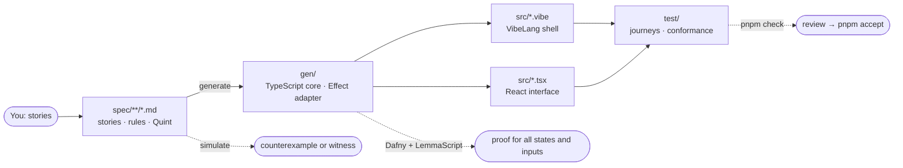
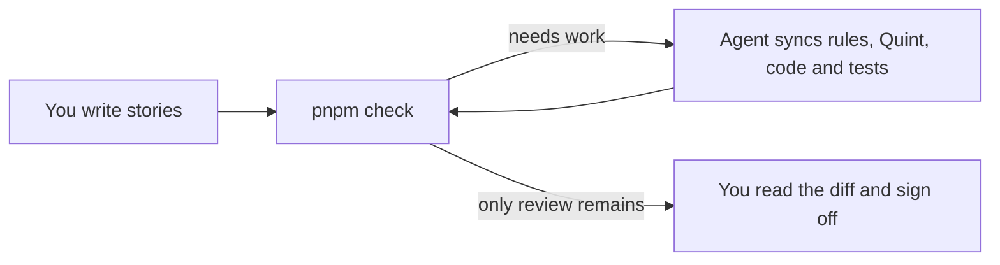

<div align="center">

# Vibestack

A full stack for building software with coding agents. You say what the
product must do; agents build it, from verified rules to a tested, running
React application, and every layer they touch is checked before you sign
off.

[](https://github.com/lalalune/vibestack/generate)

[Quickstart](#quickstart) ·
[The stack](#the-stack) ·
[Getting started](#getting-started) ·
[Studio](#studio) ·
[Build your project](#build-your-project) ·
[Commands](#commands) ·
[Examples](#examples)

</div>

---

## Quickstart

**Starting a new project? Paste this into your agent:**

```text
Help me build a new project from https://github.com/lalalune/vibestack.

Start by asking what I want to build, who it is for, and its main workflows.
Then:
1. Use the template in a new project directory, or use my existing copy.
   Read AGENTS.md and README.md in full and follow their skills.
2. Check for Node.js 26+ and Dafny 4.11 on PATH, run pnpm install, and follow
   the README's "Set up a new project" section.
3. Write my stories in spec/app/index.md, with rules and Quint under each.
4. Build the app in apps/app: its shell in VibeLang on the generated code in
   gen/, its interface in React. Add journey tests through the real UI,
   API, storage, or other services.
5. Run pnpm check and fix failures until only my review remains.
   Never edit generated files or weaken rules to pass checks.
6. Show me how to run the app, summarize what needs review, and wait for
   my request before running pnpm accept.
```

[](https://chatgpt.com/?q=Help%20me%20build%20a%20new%20project%20from%20https%3A%2F%2Fgithub.com%2Flalalune%2Fvibestack.%0A%0AStart%20by%20asking%20what%20I%20want%20to%20build%2C%20who%20it%20is%20for%2C%20and%20its%20main%20workflows.%0AThen%3A%0A1.%20Use%20the%20template%20in%20a%20new%20project%20directory%2C%20or%20use%20my%20existing%20copy.%0A%20%20%20Read%20AGENTS.md%20and%20README.md%20in%20full%20and%20follow%20their%20skills.%0A2.%20Check%20for%20Node.js%2026%2B%20and%20Dafny%204.11%20on%20PATH%2C%20run%20pnpm%20install%2C%20and%20follow%0A%20%20%20the%20README's%20%22Set%20up%20a%20new%20project%22%20section.%0A3.%20Write%20my%20stories%20in%20spec%2Fapp%2Findex.md%2C%20with%20rules%20and%20Quint%20under%20each.%0A4.%20Build%20the%20app%20in%20apps%2Fapp%3A%20its%20shell%20in%20VibeLang%20on%20the%20generated%20code%20in%0A%20%20%20gen%2F%2C%20its%20interface%20in%20React.%20Add%20journey%20tests%20through%20the%20real%20UI%2C%0A%20%20%20API%2C%20storage%2C%20or%20other%20services.%0A5.%20Run%20pnpm%20check%20and%20fix%20failures%20until%20only%20my%20review%20remains.%0A%20%20%20Never%20edit%20generated%20files%20or%20weaken%20rules%20to%20pass%20checks.%0A6.%20Show%20me%20how%20to%20run%20the%20app%2C%20summarize%20what%20needs%20review%2C%20and%20wait%20for%0A%20%20%20my%20request%20before%20running%20pnpm%20accept.)
[](https://claude.ai/new?q=Help%20me%20build%20a%20new%20project%20from%20https%3A%2F%2Fgithub.com%2Flalalune%2Fvibestack.%0A%0AStart%20by%20asking%20what%20I%20want%20to%20build%2C%20who%20it%20is%20for%2C%20and%20its%20main%20workflows.%0AThen%3A%0A1.%20Use%20the%20template%20in%20a%20new%20project%20directory%2C%20or%20use%20my%20existing%20copy.%0A%20%20%20Read%20AGENTS.md%20and%20README.md%20in%20full%20and%20follow%20their%20skills.%0A2.%20Check%20for%20Node.js%2026%2B%20and%20Dafny%204.11%20on%20PATH%2C%20run%20pnpm%20install%2C%20and%20follow%0A%20%20%20the%20README's%20%22Set%20up%20a%20new%20project%22%20section.%0A3.%20Write%20my%20stories%20in%20spec%2Fapp%2Findex.md%2C%20with%20rules%20and%20Quint%20under%20each.%0A4.%20Build%20the%20app%20in%20apps%2Fapp%3A%20its%20shell%20in%20VibeLang%20on%20the%20generated%20code%20in%0A%20%20%20gen%2F%2C%20its%20interface%20in%20React.%20Add%20journey%20tests%20through%20the%20real%20UI%2C%0A%20%20%20API%2C%20storage%2C%20or%20other%20services.%0A5.%20Run%20pnpm%20check%20and%20fix%20failures%20until%20only%20my%20review%20remains.%0A%20%20%20Never%20edit%20generated%20files%20or%20weaken%20rules%20to%20pass%20checks.%0A6.%20Show%20me%20how%20to%20run%20the%20app%2C%20summarize%20what%20needs%20review%2C%20and%20wait%20for%0A%20%20%20my%20request%20before%20running%20pnpm%20accept.)

## Why

Agents write code faster than anyone can read it. Vibestack gives every
layer of an application one owner, one way to write it and one check, so
an agent's work is held to account by tools rather than by your reading,
and what is left for you is short: a list of sentences a product owner
would call true or false.

- **Requirements are the source.** Stories and rules live in Markdown,
  each rule with its formal meaning in [Quint](https://quint-lang.org)
  underneath. Nothing else models the same state.
- **The core is generated, simulated and proved.** Types, guards and
  transitions come from the spec. Thousands of simulated traces look for a
  state that breaks a rule; [Dafny](https://dafny.org) proves every
  transition keeps every rule, for all states and inputs.
- **The rest is built on one stack.** Effects in
  [VibeLang](https://github.com/smithersai/vibelang) on
  [Effect](https://effect.website), interfaces in React on shared design
  tokens, journeys in Vitest against real services. Lint rules hold every
  package to it.
- **Agents follow one procedure.** [AGENTS.md](AGENTS.md) and the skills in
  [`.claude/skills/`](.claude/skills/) tell any agent what to write where,
  and `pnpm check` tells it what is still wrong, ending with a `next:` line.
- **You sign off.** Every changed rule is shown with its sentence and its
  Quint side by side; nothing is done until you accept it.

## The stack

| Layer | What | Checked by |
|---|---|---|
| Requirements | Stories and rules in `spec/**/*.md`, one tree for every package, edited in Markdown or [Studio](#studio) | `review`: you sign off with `pnpm accept` |
| Model | Quint under each rule: state, transitions, `always`, `step`, `sometimes` and `leadsTo` rules, laws, secrets, refinement | `model`, `always`, `sometimes`: simulated traces, counterexamples and witnesses |
| Generated core | `gen/<name>.ts`: types, guards, transitions, `parseEvent` and `parseState`; `gen/<name>.effect.vibe`: the `Machine` service | `replay`: TypeScript agrees with Quint on every simulated state |
| Proof | Dafny on the generated core, and [LemmaScript](https://github.com/midspiral/LemmaScript) `//@` contracts on hand-written logic | `proof`, with each exception recorded in `spec/lock.json` |
| Shell | HTTP, storage, queues and every other effect, in VibeLang on Effect 4 | `types`: the `vibelang` compiler over `src/`, tests and `gen/` |
| Interface | React with Vite, Tailwind CSS v4, shadcn/ui on Radix, tokens from `packages/design-system`, components in `packages/ui` with generated stories | `types`, ESLint and Stylelint rules for tokens, Storybook and browser tests |
| Tests | Whole journeys in Vitest with `@effect/vitest` and Playwright, citing the rule each step serves; conformance runs of the real app against the spec | `tests`, `traces` |
| Workspace | Node 26, pnpm workspaces, Turborepo; ESLint boundaries, Knip and Madge | `pnpm verify`, CI on every push |



What is generated from what, which test is for what, and what a green check
means are in [CONTRIBUTING.md](CONTRIBUTING.md#architecture).

## Getting started

**Needs** Node 26, [pnpm](https://pnpm.io) and
[Dafny](https://github.com/dafny-lang/dafny/releases) 4.11 on the `PATH`.

1. Click **[Use this template](https://github.com/lalalune/vibestack/generate)**
   to create your own repository, then clone it and enter its directory.
2. Install the toolchain and start Studio with every app's development
   server:

   ```bash
   pnpm install
   pnpm dev
   ```

3. In `spec/index.md`, say what the product is for. In `spec/app/index.md`,
   the requirements of the application in `apps/app`, replace the hello
   world story ([apps/app](apps/app/README.md)) with your first: who it is
   for, what they need to do, and why. Write it in Studio or in the Markdown
   file.
4. Ask your coding agent to sync. It writes the rules and Quint, builds the
   code on them in place of the hello world, runs the checks, and reports
   what needs your review.
5. Read what it reports, run the app, and sign off with `pnpm accept`.

Agents start with [AGENTS.md](AGENTS.md). All four skills (`sync`, `shell`,
`prove`, `design`) live in [`.claude/skills/`](.claude/skills/), with relative
links in [`.agents/skills/`](.agents/skills/) for Codex discovery. Keep both
directories when copying the template. ChatGPT or another client without
repository skill discovery must read the applicable `SKILL.md` files linked
from AGENTS.md explicitly; it needs access to those files or their contents
in the chat. The full instructions are read when the task needs a skill.

## Studio

```bash
pnpm dev                                # Studio on this project, and every app's dev server
pnpm studio vibestack/examples/order    # Studio alone, on an example or any directory with spec/
```

Studio opens in the browser and is where you direct the work: you shape the
stories, an agent turns them into rules, Quint and code, the checks say
where the project stands, and the application runs and builds beside it.

| You | Studio |
|---|---|
| Add, edit, delete or drag a story or rule; group rules under a heading without `Story:`; move one to another spec | Applies it to its outline, with undo (⌘Z). Reorder with Alt+↑/↓, or **Move to…** |
| Add a spec by its path, such as `billing/payments` | Creates `spec/billing/payments/index.md` and links it from its parent |
| **Publish** (⌘S) | Shows the diff, writes the Markdown, and records in `.studio/manifest.json` what was added, changed, moved or deleted and what to regenerate. Then runs the checks |
| **Run** beside Claude Code or Codex | Starts the agent on the sync prompt in the project and streams its progress; **Open** starts a new chat in the app with the same prompt |
| **Run check** | Shows each failing stage, and marks the story or rule it names |
| **Sign off** | Records the same approval as `pnpm accept` |
| **Build** beside App | Runs the project's `build` script as a job and streams its output |
| **Start** beside App | Runs the project's own development server (its `start` script, or `dev` when that is not Studio) and links to where it serves; **Stop** ends it |

Studio is itself built on the stack, in `vibestack/studio/`: its rules in
`spec/`, its server in VibeLang (`src/server.vibe`) and its page in React
(`src/page/`). To work on it:

```bash
pnpm studio vibestack/studio                  # open Studio on its own spec
pnpm --filter vibestack-studio check          # its specs, proofs and journeys
pnpm --filter vibestack-studio test           # its journeys only, Playwright included
```

## Build your project

### 1. Write the requirements

A `##` heading is a story, a `###` heading is a rule, and a `quint` block
under a rule states its formal meaning. Write the prose; the agent writes
the rules and their Quint. `spec/index.md` introduces the product and links
to each area; `spec/<name>/` holds the requirements of the package
`apps/<name>` or `packages/<name>` ([one spec tree](SPEC.md#one-spec-tree)).
`pnpm new <name>` writes `spec/<name>/index.md` with a scaffold to replace.
The format is in the [spec reference](SPEC.md#writing-a-spec).

### 2. Sync and check

Ask the agent to sync: it follows the [`sync` skill](.claude/skills/sync/SKILL.md).



Each report ends with a `next:` line; the agent follows it until only your
review remains.

### 3. Build on the generated core

`pnpm check` at the root generates each spec's core in `gen/`, and that of
`spec/app/` in `apps/app/gen/` too. The shell imports the Effect adapter:

```vibe
import { Machine, machine, apply, decodeEvent, decodeState } from "../gen/app.effect.vibe"
```

`Machine` holds the state and changes it only by an event the rules allow:
`receive(input)` decodes an untrusted value and applies it, failing with
`NotAnEvent` or `Rejected`. A shell that stores state builds its own service
on `apply` and passes what it loads through `decodeState`
([shell skill](.claude/skills/shell/SKILL.md)).

| Write | In | Following |
|---|---|---|
| HTTP, storage and other I/O | `src/*.vibe` | the [`shell` skill](.claude/skills/shell/SKILL.md) |
| The interface: components that read the state and send events through hooks over `Machine` | `src/*.tsx`, on `@repo/ui` and the design tokens | the [`design` skill](.claude/skills/design/SKILL.md) |
| Logic Quint cannot express, such as a loop | `src/*.ts` with `//@` contracts | the [`prove` skill](.claude/skills/prove/SKILL.md) |
| Whole-journey tests | `test/*.test.{vibe,tsx}` | [AGENTS.md, "Tests"](AGENTS.md#tests) |
| A driver, when the shell keeps the machine's state itself, through which `check` compares the application with the spec | `test/drivers/<name>.ts` | [SPEC.md, "Conformance"](SPEC.md#conformance) |

Keep pure logic in the spec wherever Quint can express it. When the spec
changes, the `types` stage points at the code that must follow. Never edit
`gen/`.

### 4. Review and sign off

When only `review` items remain, read the diff of `spec/`, `src/` and
`test/`. Check that each rule's sentence and Quint say the same thing, then:

```bash
pnpm accept
```

`accept` checks afresh and records what `review` lists in `spec/lock.json`,
[all or nothing](SPEC.md#review). Commit the ledger with the spec.

## Set up a new project

Before committing your application's starting point:

1. **Remove what you do not need.** Delete every directory in
   `vibestack/examples/` except `order/`: `pnpm selftest` builds its scratch
   projects from it, so it stays, with the `demo` and `examples` scripts.
   Start your application from `apps/app` and its requirements from
   `spec/app/index.md`. Update the package name, description and
   repository links for your project.
2. **Keep the toolchain guide with the toolchain.** Move this README to
   `vibestack/README.md`, update its relative links, and keep the template
   license in `vibestack/LICENSE` alongside the Vibestack code.
3. **Write your project's documentation.** Create a root `README.md` with
   the project's purpose and install, run and check commands. Set the root
   `LICENSE` to the project's chosen terms and copyright holder.
4. **Check and commit.** Run `pnpm install` and `pnpm check`, resolve their
   reports, and review and accept the spec. Commit the setup and reviewed
   ledger, then confirm `git status --short` is empty.

## Using it from another package

The tools are also the `spec` command of this package. In an existing
project, `spec init [<dir>]` adds what the stack needs without replacing
anything you have: all four skills in `.claude/skills/` and their relative
links in `.agents/skills/`, the spec reference in `SPEC.md`, the procedure in
`AGENTS.md` between `<!-- vibestack:start -->` markers (and `CLAUDE.md`
importing it), a `tsconfig.json` and `vitest.config.ts` for VibeLang, an
empty `spec/index.md`, `.gitignore` entries for what the tools own, and the
`dev`, `check`, `gen`, `accept`, `build` and `test` scripts with the
VibeLang and Effect packages at the versions the tools are tested with. Run
it again after an upgrade to refresh the procedure.
It writes no tests: `check` adds a `test` script on the one Vitest
configuration when `test/` first appears, and a driver to fill in when
`src/` first keeps a machine's state.

## Commands

`<dir>` is any project directory containing `spec/`; it defaults to the
current one. Installed as a package, use `pnpm exec spec <command> [<dir>]`.

| Command | Does |
|---|---|
| `pnpm dev` | Starts Studio on this project and every workspace package's `dev` script, together |
| `pnpm studio [<dir>]` | Opens Studio alone, on one project |
| `pnpm check [<dir>] [--json]` | Checks spec, source and tests; ends with a `next:` line ([JSON shape](CONTRIBUTING.md#changing-the-tools)) |
| `pnpm quick` | Types, lint and tests of what changed |
| `pnpm verify` | Everything CI runs: build, types, tests, browser tests, checks, lint, Knip, Madge and the selftest, for every workspace package |
| `pnpm gen [<dir>]` | Generates `gen/` only |
| `node vibestack/spec.ts watch [<dir>]` | Rechecks when a spec, source file or test changes |
| `pnpm accept [<dir>]` | The user's sign-off: checks afresh and records what `review` lists, [all or nothing](SPEC.md#review) |
| `pnpm accept unproved` | Records the listed obligations as simulated only. The user's decision |
| `pnpm new [<path>]` | Fills an empty root index or creates a child [starter spec](SPEC.md#writing-a-spec) |
| `node vibestack/spec.ts init [<dir>]` | Sets up an existing project ([above](#using-it-from-another-package)) |
| `node vibestack/spec.ts migrate [<dir>]` | Consolidates old review ledgers into `spec/lock.json`, keeping their approvals |
| `pnpm demo` | Runs the order example's scripted checkout session |
| `pnpm examples` | Installs and checks every example, outside CI |
| `pnpm selftest` | Breaks the pipeline one way at a time and checks each break is caught |
| `pnpm build` | Compiles the tools into `dist/`, the packaged `spec` command |

| Exit code | Means |
|---|---|
| 0 | green |
| 1 | a `✗`, or an error |
| 2 | bad arguments; prints the usage line |

CI runs `pnpm verify` on each pull request and push with the same fixed
profile as local checks, and a fresh nightly run with a larger fixed profile
([CI](CONTRIBUTING.md#ci)).

## Examples

Each example is a whole application on the stack, standing apart from the
workspace.

| Project | What it covers | Open in Studio |
|---|---|---|
| [Order checkout](vibestack/examples/order/README.md) | Guards, payments, cancellation and a proved event ledger | `pnpm studio vibestack/examples/order` |
| [Team dashboard](vibestack/examples/dashboard/README.md) | Shared spreadsheets, chat notifications and a project registry | `pnpm studio vibestack/examples/dashboard` |
| [Shared to-do list](vibestack/examples/fullstack/README.md) | HTTP server, browser client and two tabs over an unreliable network | `pnpm studio vibestack/examples/fullstack` |
| [Assistant](vibestack/examples/assistant/README.md) | Trusted senders, bounded turns, late replies, confirmation before payment and a secret card | `pnpm studio vibestack/examples/assistant` |

## Repository

| Path | Holds |
|---|---|
| `spec/` | The one spec tree: the product, and a directory per app or package |
| `apps/app` | A hello world application with one of each thing the stack offers, to replace with yours |
| `packages/design-system` | Design tokens, built into Tailwind's theme |
| `packages/ui` | Shared React components, with generated stories |
| `vibestack/` | The tools: generator, simulator, prover, Studio, testing and design helpers |
| `.claude/skills/` | What agents read before each kind of work: `sync`, `shell`, `prove`, `design` |
| `.agents/skills/` | Relative links to the same skills for Codex discovery |
| [AGENTS.md](AGENTS.md), [SPEC.md](SPEC.md), [CONTRIBUTING.md](CONTRIBUTING.md#architecture) | The procedure, the spec reference, and the map |

## Contributing

See [CONTRIBUTING.md](CONTRIBUTING.md).

## License

[MIT](LICENSE)
