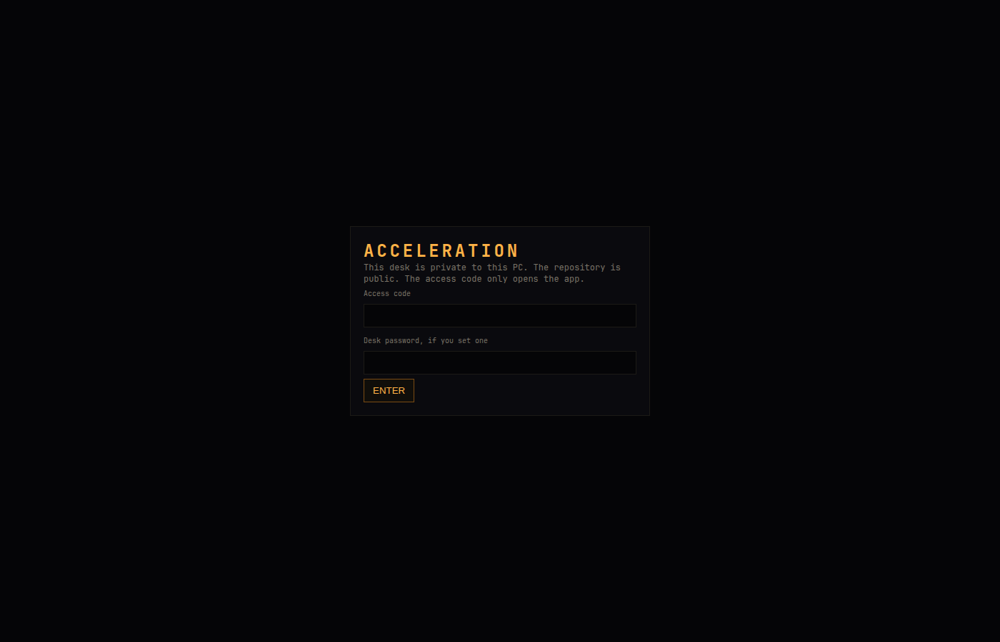
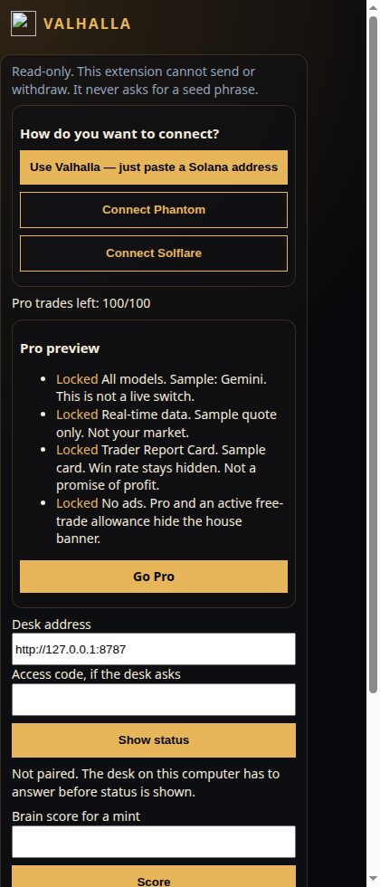
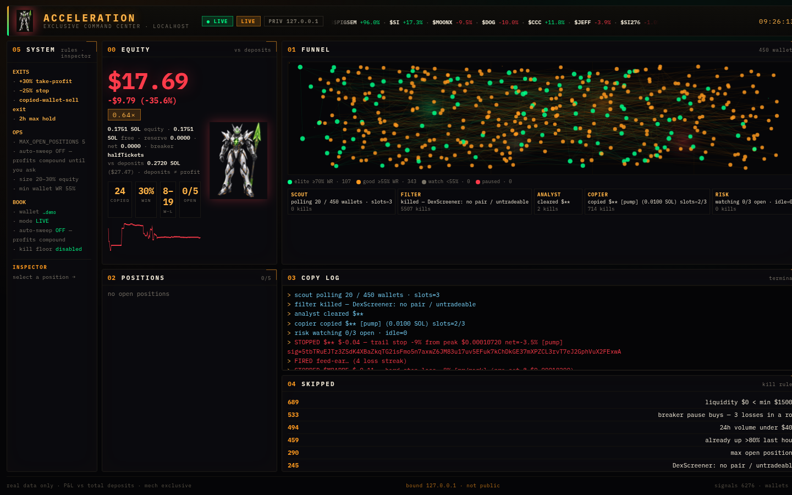
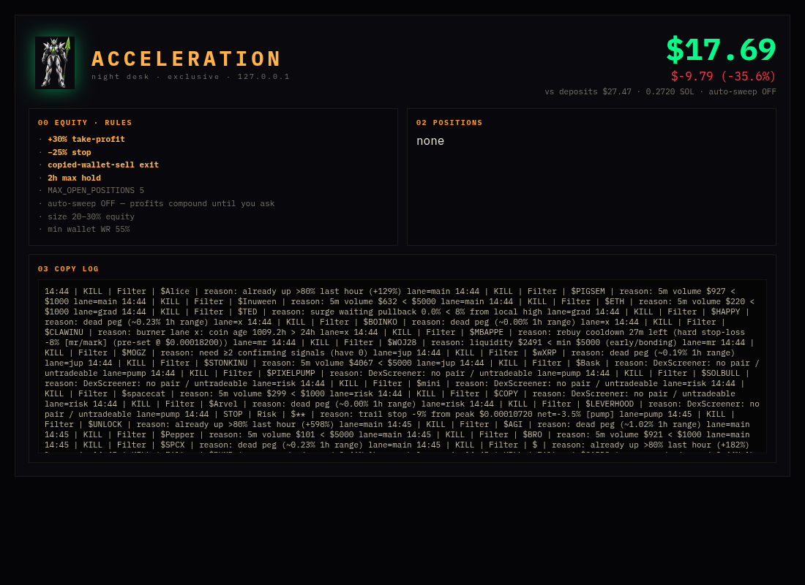

<div align="center">
  
  <h1>elizaOS</h1>
  <p><strong>Your agentic operating system.</strong></p>
  <p>
    <a href="https://eliza.app">Eliza</a> ·
    <a href="https://cloud.eliza.app">Eliza Cloud</a> ·
    <a href="https://os.eliza.app">elizaOS downloads</a> ·
    <a href="https://docs.elizaos.ai/">Documentation</a>
  </p>
</div>

## Valhalla / ACCELERATION


<p>
  <a href="https://github.com/TokenJunction/eliza-valhalla/releases/latest/download/Valhalla-Setup-x64.exe"></a>
  <a href="https://github.com/TokenJunction/eliza-valhalla/releases/latest/download/valhalla-phone.apk"></a>
  <a href="https://valhalla-app.xyz/extension/"></a>
</p>

### Downloads

- [Download for Windows](https://github.com/TokenJunction/eliza-valhalla/releases/latest/download/Valhalla-Setup-x64.exe) (`Valhalla-Setup-x64.exe`)
- [Download for Android](https://github.com/TokenJunction/eliza-valhalla/releases/latest/download/valhalla-phone.apk) (`valhalla-phone.apk`)
- [Add to Chrome](https://valhalla-app.xyz/extension/) (install steps until `CHROME_WEB_STORE_URL` is set)
- [Checksums](https://github.com/TokenJunction/eliza-valhalla/releases/latest/download/SHA256SUMS.txt)
- [Chrome extension zip](https://github.com/TokenJunction/eliza-valhalla/releases/latest/download/Valhalla-Chrome-Extension.zip)
- [Chrome store zip](https://github.com/TokenJunction/eliza-valhalla/releases/latest/download/valhalla-extension-store.zip)

Release v0.2.0.





Windows may say the publisher is unknown while the file is unsigned. Choose More info, then Run anyway.

### Chrome extension

The Add to Chrome button opens the pictured guide. It does not download a file. One-click install waits on the Chrome Web Store. Until that review, the button stays on [the install page](https://valhalla-app.xyz/extension/).

Chrome on Android cannot install extensions. Use desktop Chrome.

1. Download the folder from that page and open it until you see `manifest.json`.
2. Open `chrome://extensions` and turn on Developer mode.
3. Choose Load unpacked and select that folder. Do not select the zip.

The extension is read-only. It cannot send or withdraw. The store upload is `store/chrome/valhalla-extension-store.zip`. The copy-paste fields are in `store/chrome/SUBMIT.md`.

This fork adds the Valhalla desk. TokenJunction LLC publishes Valhalla. It is the ACCELERATION command center for a small Solana copy bot. The test phone build is a sideload APK, not a Play Store app.

**Site:** [valhalla-app.xyz](https://valhalla-app.xyz/)

**Download:** [Windows](https://github.com/TokenJunction/eliza-valhalla/releases/latest/download/Valhalla-Setup-x64.exe) · [Android](https://github.com/TokenJunction/eliza-valhalla/releases/latest/download/valhalla-phone.apk) · [Add to Chrome](https://valhalla-app.xyz/extension/)

### Quick start

1. On a PC, open `plugins/plugin-valhalla-copybot`.
2. Copy `.env.example` to `.env` and add a Google AI Studio key. Leave live trading false.
3. Double-click `start.bat` (Windows) or run `./start.sh` (Mac or Linux).
4. The desk opens at `http://127.0.0.1:8787`.
5. On a phone, install the test APK. Allow installs from unknown sources. The app opens on the pairing screen even if the PC is off.

### Safety

The desk and the phone have no send or withdraw control. Wallet keys stay on the PC, encrypted, and are never put on the phone. Trading is read-only until you arm live on the PC. Ad units come from the signed monetization file.

See [CHANGELOG.md](CHANGELOG.md) and [docs/ROADMAP.md](docs/ROADMAP.md).





elizaOS is an open-source TypeScript framework and product stack for autonomous
AI agents. This monorepo contains the core runtime, the Eliza app, the CLI,
cloud services, native bridges, and first-party plugins. Linux and Android
distribution tooling lives in [`packages/os`](packages/os/README.md).

## Choose a starting point

| Goal | Start here |
| --- | --- |
| Use Eliza | [Open the web app](https://cloud.eliza.app), visit [Eliza downloads](https://eliza.app/downloads), or use a published [GitHub release](https://github.com/elizaOS/eliza/releases) |
| Run this repository | Follow [Run Eliza from source](#run-eliza-from-source) |
| Build an agent or plugin | Start with [the runtime](#build-an-agent) and the [developer docs](https://docs.elizaos.ai/) |
| Contribute | Read the [required contribution rules](#contributing) and [AGENTS.md](AGENTS.md) |
| Run a whole device as elizaOS | Start with the build requirements and target guides in [`packages/os`](packages/os/README.md) |

## Run Eliza from source

The repository pins Bun and Node versions in [`package.json`](package.json).
Install those versions, then:

```bash
git clone --filter=blob:none https://github.com/elizaos/eliza.git
cd eliza
bun install
bun run dev
```

`bun install` also prepares submodules and patches, provisions supported host
build prerequisites, and builds or verifies the staged desktop
`libelizainference`. The embedding GGUF remains runtime-managed and downloads
automatically during local-inference warmup. Fetch archived artifact fixtures explicitly with
`bun packages/scripts/fetch-archive-artifacts.ts` when needed.

Common repository commands:

```bash
bun run dev:local   # app + API with the runtime chooser (local agent, own provider keys; Cloud sign-in not required)
bun run start       # run the standalone agent host (API only, no UI; use bun run dev for the app)
bun run build       # build the workspace with Turbo
bun run verify      # dependency, type, lint, and audit gates
bun run test        # repository end-to-end test lane
bun run test:e2e    # end-to-end lane
bun run cloud:mock  # local Eliza Cloud stack with mocks
```

Package build/test commands are in each package's README. Use
`bun run --cwd <package> <script>` to scope a command.

## Benchmark

Use Python 3.11+ and install the dependencies required by the selected suite, then run from
the repository root:

```bash
PYTHONPATH=packages python3 -m benchmarks.orchestrator list-benchmarks
PYTHONPATH=packages python3 -m benchmarks.orchestrator run --benchmarks <id> --provider <provider> --model <model>
```

See [benchmarks](packages/benchmarks/README.md) for setup. Live benchmarks require
the selected provider's credentials and may incur usage costs.

## What is in the stack?

### Eliza

Eliza is the user-facing agent app for web, desktop, and mobile targets. Its
capabilities are supplied by the runtime and installed plugins, including:

- chat, voice, memory, knowledge, and document workflows;
- messaging and workspace connectors;
- calendar, reminders, inbox, goals, health, and other personal-assistant
  domains;
- browser and desktop automation;
- camera, phone, messages, contacts, location, and other native device bridges;
- non-custodial EVM and Solana wallet operations with approval boundaries; and
- scheduled workflows, coding-agent orchestration, and installable app views.

Availability depends on the operating system, installed plugins, granted
permissions, and configured model or service providers. Package-level READMEs
document the exact support and setup for each capability.

### The framework

The framework is model-agnostic and extended through plugins:

- [`@elizaos/core`](packages/core) defines `AgentRuntime`, the canonical types,
  authorization, memory and state primitives, and plugin contracts.
- [`@elizaos/agent`](packages/agent) assembles a standalone agent and HTTP
  backend around the core runtime.
- [`@elizaos/app`](packages/app) provides shared application hosting,
  API, and platform orchestration for Eliza app targets.
- [`@elizaos/ui`](packages/ui) contains the shared React UI used by app
  surfaces.

A plugin exports a `Plugin` object. Plugins can register actions, providers,
evaluators, services, model handlers, routes, events, tests, and app views. See
the [plugin component guide](https://docs.elizaos.ai/plugins/components) and
the first-party implementations under `plugins/`.

### Local inference

[`@elizaos/plugin-local-inference`](plugins/plugin-local-inference) provides the
Eliza-1 on-device path. The current Eliza-1 registry contains 2B, 4B, 9B, and
27B text tiers based on Gemma 4, plus local embeddings, speech, vision, and
image-generation assets. Hardware detection and model routing select supported
backends; after the required assets are downloaded, eligible operations can run
without a network connection.

Local inference is not forced on hardware that cannot support it. Eliza can
route each model capability to local, direct-provider, or Eliza Cloud backends.

### Eliza Cloud

[Eliza Cloud](https://cloud.eliza.app) is optional. It provides account and
authentication services, hosted model routing, application and agent
deployment, remote connectivity, and cross-device product services. The local
runtime and direct model-provider configuration remain first-class paths.

### elizaOS distributions

[`packages/os`](packages/os/README.md) owns bootable Linux and AOSP distributions,
installers, release manifests, and OS toolchains. Application shells and native
runtime bridges live in their owning app and plugin packages.

## Build an agent

To embed the runtime directly without an application host, import
`@elizaos/core`. The scenario runner provides executable integration coverage
against a real runtime and, when configured, live models.

## Repository map

```text
packages/        runtime, hosts, UI, CLI, docs, cloud, native code, and tooling
plugins/         first-party model, connector, domain, app, and device plugins
packages/scripts/ repository-wide checks, test orchestration, and release tools
patches/         dependency patches applied during installation
```

Every maintained package or plugin should explain its public surface, scripts,
configuration, and local constraints in its own `README.md`. Read that README
before making changes. The root [AGENTS.md](AGENTS.md) is the only repository
agent guide; do not add nested `AGENTS.md` files.

## Contributing

> [!IMPORTANT]
> **The [contribution rules](CONTRIBUTING.md) are required for all issues and PRs.**
> Stay within the approved minimum viable product (MVP) and product requirements
> document (PRD). Maintainers will close unnecessary work and apply contributor
> penalties.

- Contributors must write and submit issues by hand on GitHub. Agents must not
  draft or create issues. See [the human-only issue rule](CONTRIBUTING.md#human-only-issue-creation).
- Report real bugs or missing approved MVP requirements. Link the PRD and MVP
  plan. New features need human maintainer discussion and approval, then updates
  to both plans before implementation issues or PRs are opened.
- Prove a useful improvement with before-and-after behavior or relevant scores.
  Prefer cleanup, removal, reuse, and combined types and functions. Add new types
  or code only when necessary. Explain the research, alternatives, and choice.
- Do not add unnecessary tests, defensive code, validation, or truncation.
  Provide real end-to-end test results. Use existing tests first. Avoid new unit
  tests, mock-only proof, and tests that repeat the implementation.
- Every UI PR needs an uploaded MP4 explainer and walkthrough, video evidence of
  the changed flow, desktop and mobile screenshots, the app visual audit, and
  detailed steps to test the change.
- Write issues and PRs in ASD-STE100 Simplified Technical English. Use short,
  direct sentences and explain technical terms for a non-technical reader.
- Slop bounty work: star and fork the repository first, use real LLM calls,
  make no UI changes, and test in more than one agent client. See
  [Slop bounty contributions](CONTRIBUTING.md#slop-bounty-contributions).

elizaOS focuses on its first-party runtime, applications, and maintained integrations.
We no longer accept third-party plugins or registry items, including new listings,
listing updates, and registry submission tooling. Related issues and pull requests
will be closed as out of scope.

Submit changes through a pull request against `develop`; follow
[AGENTS.md](AGENTS.md) and the owning package's README. Include verification of
the changed behavior.

Report vulnerabilities privately through
[GitHub Security Advisories](https://github.com/elizaOS/eliza/security/advisories/new)
or `security@elizalabs.ai`.

## License

[MIT](LICENSE)
