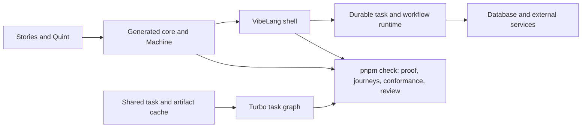

# Smithers, VibeLang and Vibestack CI research

Research snapshot: November 13, 2026. The strongest immediate opportunity is to optimize and cache Vibestack's self-test, then enable shared task caching. Smithers has a substantial build system and durable workflow engine, but adopting it wholesale would replace capabilities Vibestack already has and would not automatically make its TypeScript builds and tests cacheable. VibeLang's new experimental workflow support is a more natural product integration than replacing the build runner.

## Evidence and versions

The source snapshots inspected were [Smithers `088be6e`](https://github.com/smithersai/smithers/tree/088be6e74aabbce4d847f714b8059f989f792d54), [VibeLang `b415579`](https://github.com/smithersai/vibelang/tree/b4155797794071fb35da410d8222f16072db95a4), and the local Vibestack checkout, whose HEAD was `f2ef5e6315f79f9b61cf283235c4956e3e964404`. Vibestack has substantial uncommitted work; local observations below describe that working tree, while CI measurements identify the committed revision they ran. Research added this document only.

Registry metadata and the published VibeLang compiler/runtime archives were inspected without installing or executing downloaded code. Repository tests were read, not run. Existing GitHub Actions runs supplied the timing evidence. The supplied Eliza Cloud billing URL was not accessible through the web reader and supplies no evidence about these tools.

| Component | Current evidence | Integration consequence |
| --- | --- | --- |
| Vibestack | VibeLang/compiler/runtime/Vite adapter `0.0.12`; Effect/platform/test `4.1.1`; Node 26; pnpm `10.24.0`; Turbo `^2.11.11` | Preserve the existing stack and version alignment. |
| VibeLang | npm `latest` is `0.0.13`, published November 13; core alpha plus experimental features | A coordinated upgrade is available, subject to compatibility validation. |
| Smithers source | Current package documentation and manifests target Effect `4.1.1` | Source-level compatibility is plausible. |
| Published Smithers | `smthrs` latest is `0.35.0`; next is `1.0.0-rc.16`. Published `@smthrs/flow`, `@smthrs/engine-store`, and `@smthrs/build-cli` RC16 declare Effect `4.0.5` | Do not infer that installing `@next` gives the current source or fits Vibestack's Effect dependency. |

Sources: Vibestack `package.json` and `pnpm-workspace.yaml`; [VibeLang package metadata](https://registry.npmjs.org/vibelang/0.0.13), [runtime metadata](https://registry.npmjs.org/vibelang-runtime/0.0.13), [Smithers CLI registry](https://registry.npmjs.org/smthrs), [published flow RC](https://registry.npmjs.org/@smthrs%2Fflow/1.0.0-rc.16), [current Smithers support policy](https://github.com/smithersai/smithers/blob/088be6e74aabbce4d847f714b8059f989f792d54/RELEASE_SUPPORT.md).

## What the creator's claims mean

There are three separate capabilities:

1. **Durable execution:** a workflow journals completed steps, persists waits, and resumes after a process dies. This addresses long-running application or agent work.
2. **Incremental build execution:** a dependency graph decides what must run. Complete action inputs and declared outputs let a cache replace execution with a previously computed result.
3. **Formal verification:** a verifier proves stated properties of an admitted program/model. A durable runtime or a cache does not itself establish those properties.

A workflow journal answers “what happened in this run?” A build cache answers “has this computation already succeeded for these inputs?” A review ledger answers “which requirements did a person approve?” These records have different lifetimes and authority. They should not be merged into one cache.

The Bazel comparison is real at the architectural level: named targets, explicit inputs/dependencies, action identity, a content-addressed artifact store, and a shared result cache. Bazel likewise distinguishes action metadata from artifact bytes. It does not mean Smithers implements Bazel's protocols or provides identical hermeticity or remote execution. [Bazel remote-cache architecture](https://bazel.build/remote/caching), [Smithers build overview](https://github.com/smithersai/smithers/blob/088be6e74aabbce4d847f714b8059f989f792d54/packages/smithers/build/README.md).

“Only ever run once” needs qualification. A completed, valid, available cache entry can suppress a later equivalent computation. Eviction, changed inputs, failed attempts, unavailable caches, different environments, and simultaneous cold misses can require work again. First-writer-wins publication does not prevent two machines from computing before either publishes. Run ownership and external side-effect idempotency are separate mechanisms.

## Smithers capabilities and limits

### Build graph and CI as code

`PACKAGE.ts` or `PACKAGE.vibe` declares targets; `WORKSPACE.ts` declares the workspace and toolchain. Inputs and target references create dependency edges. Commands select kinds and labels, such as `smthrs test '//packages/...'`, `smthrs ci '//...'`, or `smthrs target '//app:build'`. Query, graph, plan, explain, and affected-selection commands make the graph inspectable. Affected selection is conservative: a target whose input contract is incomplete, and its dependents, can be selected for any change. It is not automatic test-level dependency analysis of arbitrary JavaScript. [Adoption guide](https://github.com/smithersai/smithers/blob/088be6e74aabbce4d847f714b8059f989f792d54/packages/smithers/build/docs/workspace/adoption.md), [affected selector](https://github.com/smithersai/smithers/blob/088be6e74aabbce4d847f714b8059f989f792d54/packages/smithers/build/build-cli/src/Affected.ts#L176-L183).

`GithubCiGen` generates and drift-checks workflows from declared jobs, toolchains, and target selections. The current build API also has `Github.Workflow`, `Github.Setup`, and `Github.CiGen`. Jobs name targets rather than arbitrary shell command strings. This can make local and CI entry points agree, but requires expressing each existing gate as a supported target. [CI generator reference](https://github.com/smithersai/smithers/blob/088be6e74aabbce4d847f714b8059f989f792d54/packages/smithers/build/docs/reference/targets/github-ci-gen.md).

### Cache identity and artifact restoration

The build key hashes the target's rule/body identity, canonical attributes, declared file contents, dependency keys, Node/platform/architecture, lockfile, implementation fingerprint, environment layers, and capabilities. Selected executable paths and bytes are also measured. Arbitrary subprocesses and editable installed dependency files are not discovered magically; they must be covered by declarations or the installation contract. [Key and executable contracts](https://github.com/smithersai/smithers/blob/088be6e74aabbce4d847f714b8059f989f792d54/packages/smithers/build/build-cli/docs/concepts/caching.md#what-a-key-covers).

Declared outputs are stored by digest, validated, and restored. The remote protocol uses `/ac` for action results and a CAS for artifact bytes. Local hits avoid the network; remote hits hydrate local state. Network trouble generally loses reuse rather than failing a correct build. Output restoration validates paths and digests, with staged publication and explicit concurrency limits. These are useful engineering features, not just a directory of logs. [Cache implementation](https://github.com/smithersai/smithers/blob/088be6e74aabbce4d847f714b8059f989f792d54/packages/smithers/build/build-cli/src/Cache.ts).

The shared tier is subject to admission rules. A result produced without enforced confinement stays local. The executor uses Linux bubblewrap, macOS seatbelt, or an explicitly declared Docker environment; the declared sandbox, read set, write set, and toolchain must work for a result to be publishable. Remote cache identity is not proof that an arbitrary publisher computed the answer honestly. Separate read/write authority remains necessary. [Execution boundary](https://github.com/smithersai/smithers/blob/088be6e74aabbce4d847f714b8059f989f792d54/packages/smithers/build/build-cli/docs/concepts/execution.md), [publication enforcement](https://github.com/smithersai/smithers/blob/088be6e74aabbce4d847f714b8059f989f792d54/packages/smithers/build/build-cli/src/internal/PackageRunner.ts#L914-L978).

**The material limitation:** standard `TsBuild`, `Typecheck`, `Vitest`, `EsLint`, and `Dprint` targets remain non-cacheable in the inspected source. `NodeTest` and `ToolBuild` can explicitly opt in; several native rules have their own cache policy. Complete installed-tool identity and output restoration are still requirements for enabling the standard targets. [Cacheability table](https://github.com/smithersai/smithers/blob/088be6e74aabbce4d847f714b8059f989f792d54/packages/smithers/build/docs/workspace/caching.md#cacheability), [open issue 1871](https://github.com/smithersai/smithers/issues/1871), [Vitest target](https://github.com/smithersai/smithers/blob/088be6e74aabbce4d847f714b8059f989f792d54/packages/smithers/build/targets/src/Vitest.ts#L97-L139).

Consequently, translating Vibestack's Vitest and TypeScript tasks directly to the corresponding Smithers catalog targets could reduce cache reuse. A custom/native target with a complete contract is an alternative, but then the integration must supply and validate that contract.

### Durable flows

Smithers separates action declarations, pure plans, effect implementations, and engines. Its durable engine records attempts and outcomes, persists timers and deferreds, and fences writes to a run's current owner. Its step cache distinguishes disposable lookup entries from recorded results needed to replay a particular run. The digest supplied to the standalone step-cache package is the caller's responsibility. [Flow API](https://github.com/smithersai/smithers/blob/088be6e74aabbce4d847f714b8059f989f792d54/packages/smithers/flows/flow/README.md), [step cache](https://github.com/smithersai/smithers/blob/088be6e74aabbce4d847f714b8059f989f792d54/packages/smithers/flows/step-cache/README.md).

Actions distinguish replayable computations, compensable workspace effects, and irreversible external effects. The durable store transaction can atomically record its own state and journal; it cannot atomically commit a remote payment or deployment. Provider idempotency keys, fencing, or compensation remain necessary. `Action.once` serializes within one module instance, not every process in a distributed deployment. [Durable engine store](https://github.com/smithersai/smithers/blob/088be6e74aabbce4d847f714b8059f989f792d54/packages/smithers/flows/engine-store/README.md#what-it-gives-you), [external write semantics](https://github.com/smithersai/smithers/blob/088be6e74aabbce4d847f714b8059f989f792d54/packages/smithers/flows/flow/docs/concepts/execution-identity.md#internal-attempts-and-external-writes).

## What VibeLang actually ships

VibeLang compiles direct-style Effect programs to JavaScript. Typed errors and required services, resource scopes, and concurrent operations are useful static guarantees, but do not prove application requirements. Its core remains compatible with Vibestack's Node/React/Effect direction. The current alpha pins Effect `4.1.1`; a version change should move compiler, runtime, and Vite adapter together. [Current README](https://github.com/smithersai/vibelang/blob/b4155797794071fb35da410d8222f16072db95a4/README.md), [alpha feature matrix](https://github.com/smithersai/vibelang/blob/b4155797794071fb35da410d8222f16072db95a4/docs/user/src/setup/alpha.md).

### Workflows are now experimental implementation, not only a proposal

Some indexed website text still says that language-level durability does not exist. The inspected source and published `0.0.13` archives are newer: the compiler skill describes experimental `task` and `workflow` declarations, and the runtime archive includes `dist/durable.js`, `dist/experimental/Durable.js`, and SQL-store code. The feature requires `vibe.experimental: ["builtins"]`. It is outside the supported core alpha and can change or be removed.

A task declares serializable arguments/results and an effect implementation. A workflow composes tasks into a plan; its body restricts ambient clock/randomness, mutation, loops, and recursive step graphs. The runtime supports an in-memory engine and a SQL-backed store, replay, waits, and task result caching. Cross-run cache reuse requires an implementation version; cached tasks must use the sealed tier. These are task-result keys, not automatic repository file/dependency discovery. [Tasks and workflows](https://github.com/smithersai/vibelang/blob/b4155797794071fb35da410d8222f16072db95a4/docs/user/src/vibelang-features/119-tasks-and-workflows.md), [runtime cache contract](https://github.com/smithersai/vibelang/blob/b4155797794071fb35da410d8222f16072db95a4/packages/runtime/src/experimental/Durable.ts#L300-L344).

The crash semantics are explicit in an upstream integration test: if a process dies after an external action but before its completion is journaled, the action appears twice after restart. Completed earlier steps replay successfully. This is useful durability with an ordinary crash window, not exactly-once external delivery. That test uses Bun, so it is not evidence that this journey has passed on Vibestack's required Node 26 runtime. [Crash test](https://github.com/smithersai/vibelang/blob/b4155797794071fb35da410d8222f16072db95a4/packages/runtime/tests/experimental-durable-sql.test.ts#L91-L139).

### Formal verification is accepted design, not an available compiler feature

VIP-43 proposes `theorem`, `spec function`, and `proof` blocks, erased from JavaScript, with `vibelang prove` lowering to LemmaScript and Dafny. It was accepted November 7 and clarified as outside the alpha. Its source explicitly says nothing is implemented; there is no usable opt-in or proof command. [VIP-43](https://github.com/smithersai/vibelang/blob/b4155797794071fb35da410d8222f16072db95a4/docs/design/vips/0043-theorems.md).

The proposed proof boundary is plain functions. Effect programs are outside it; `number` is modeled as an unbounded integer rather than all JavaScript numeric behavior. The design also permits explicit trusted declarations and treats imported ordinary code specially. Vibestack would need its own strict acceptance policy and boundary checks even after this syntax lands. This is complementary to Quint models, transition invariants, reachability, conformance, and product-owner review—not an automatic replacement for them. [Formal semantics and trust boundary](https://github.com/smithersai/vibelang/blob/b4155797794071fb35da410d8222f16072db95a4/docs/design/src/900-appendices.md#appendix-f-theorems-and-proofs-vip-43).

## Vibestack's measured bottleneck

These are observations of completed runs, not a controlled benchmark or an estimate of future speedups.

| Revision and run | Verify job | Verify command | Self-test command | Self-test job |
| --- | ---: | ---: | ---: | ---: |
| `f2ef5e6`, [43487206776](https://github.com/lalalune/vibestack/actions/runs/43487206776) | 2m 14s | 46.36s | 36m 50s | 38m 30s |
| `3e23575`, [43476840719](https://github.com/lalalune/vibestack/actions/runs/43476840719) | 3m | 1m 39s | 22m 29s | 23m 59s |
| PR into develop, [43491726392](https://github.com/lalalune/vibestack/actions/runs/43491726392) | 3m 28s | 2m 03s | Not selected | Not selected |

The first run reused 19 of 22 Turbo tasks and explicitly reported remote caching disabled. Its setup restored pnpm and task-cache archives, then ran `prepare` and a real build outside Turbo. The remaining uncached verification included live checks; the self-test passed 89 cases. Since self-test and verify run in parallel, shortening an already-fast verify command does not shorten the full gate while self-test dominates it.

The current workflow runs self-test directly as `pnpm selftest`, not as a cacheable Turbo task. Its fixtures live in newly created OS temporary directories, outside the checkout's restored `.spec-cache` trees. One pristine project is checked and copied within the suite, which saves repeated work inside that process; it is recreated in the next job. Tests exercising acceptance intentionally require fresh work. See local `vibestack/selftest.ts:30-104`, `.github/workflows/ci.yml:49-55`, and `.github/actions/setup/action.yml:17-27`.

Many individual self-test durations are tens of minutes. Tests run concurrently and share a subprocess queue, so these elapsed durations can include queue wait; they overlap and cannot be summed or treated as isolated CPU costs. `vibestack/run.ts` already limits subprocesses with `availableParallelism()`, and Dafny uses one core per invocation. Profile queued time, subprocess execution, and memory before changing concurrency; nested CLI processes have their own limiters.

The same `3e23575` develop head also triggered a [PR-to-main run](https://github.com/lalalune/vibestack/actions/runs/43476877846) while a [main push run](https://github.com/lalalune/vibestack/actions/runs/43476889077) ran nearby. The workflow's concurrency key groups PRs by number but pushes by SHA, so newer pushes do not cancel earlier push SHAs. PR merge refs, target branches, and policy contexts can differ; reuse must preserve those distinctions rather than declaring the runs equivalent from a head SHA alone.

## Optimization plan in priority order

### 1. Put self-test under the existing task cache

Extend Turbo to own the existing selftest script and keep the required CI job. Start with conservative input coverage: self-test code, tool implementation, fixtures, order example, copied packages, generated-template source documents, manifests/lockfile, and relevant configs. Include a checked toolchain fingerprint covering exact Node, Dafny, Z3 and platform identity. Cache only successful completed runs. This can eliminate the dominant work on an identical repeat; it will not accelerate the first run after a relevant tool change.

Do not cache a whole acceptance decision, lower proof budgets, skip existing cases, or infer success from the presence of a directory. Acceptance must retain its current fresh verification behavior. A cache regression should change a fixture or tool, verify a miss, and confirm that an intentionally broken pipeline still fails.

### 2. Use a true remote Turbo cache

The current GitHub archive cache warms later CI jobs but is not a live shared task service for developers. It is also partitioned by job and saves an immutable archive after execution. Turbo already supports local-to-CI and CI-to-local reuse through managed or self-hosted remote caching; replacing Turbo is unnecessary to obtain that capability. [Turbo remote caching](https://turborepo.dev/docs/core-concepts/remote-caching), [GitHub archive semantics](https://docs.github.com/en/actions/reference/workflows-and-actions/dependency-caching).

Use distinct publisher and reader permissions, isolate untrusted PR work, and consider signed artifacts. A hash proves the artifact's identity, not that its producing test ran correctly. Proof-result caches deserve the same publisher discipline as executable artifacts.

Fix key compatibility first. `turbo.json` currently hashes `CI`, `FUZZ_RUNS`, and `FUZZ_SEED` globally. Local and CI values differ, and a higher fuzz budget unnecessarily changes build and generator keys. Scope the fuzz values to tasks that consume them; keep CI-dependent inputs where behavior actually differs. Pin an exact Node 26 release or hash the resolved toolchain: `.nvmrc` currently contains only `26`. Separate platform-sensitive outputs by OS/architecture. [Turbo environment hashing](https://turborepo.dev/docs/crafting-your-repository/using-environment-variables).

### 3. Profile and improve the cold self-test path

Record per-stage and per-subprocess queue/run times, cache hits, peak RSS, and total wall time on the same runner class. Use several identical cold runs before comparing changes. Candidate improvements are a bounded number of balanced shards, less repeated fixture setup, and reusable deterministic fixture computations. Preserve fresh-cache cases that test invalidation and acceptance.

The current global subprocess limiter is useful; blindly increasing parallelism is not a plan. Sharding adds setup and can multiply compiler/solver memory. A faster runner may help a CPU-bound cold suite, but measure cost per successful gate as well as wall time. No cold-run speedup has been established by this research.

### 4. Remove redundant work and unnecessary invalidation

`prepare` runs a real build on each installation before the Turbo graph can restore the build result. Preserve the install experience while routing reusable generation/build work through its existing cacheable owner. The sampled build portion was only a few seconds, so this is secondary to self-test.

`check` reruns application typechecking and tests even when related Turbo tasks just ran or were restored. Root and Studio checks need one authoritative owner for each required journey. Refactor that ownership if profiling justifies it; do not add a skip flag that makes `pnpm check` less complete.

Task inputs also include broad `vibestack/**` trees. Narrow them only after dependency coverage is explicit. The goal is that a README or unrelated UI change does not rebuild every tool-dependent package while an actual generator or proof change invalidates everything it affects.

### 5. Improve the existing spec cache before replacing it

`vibestack/cache.ts` already separates model, simulation and proof toolchains; `spec.ts` keys simulations on imported meanings, harness, and budgets, and proofs on the unit, manual proof text, relevant library, and offered lemmas. `accept` requests fresh results. These are good foundations.

Current limitations matter for shared reuse: the proof identity contains the absolute Z3 path; garbage collection retains only entries used by the latest completed check; cached JSON is trusted as a local result. A shared store should use immutable content keys, authenticated provenance, schema validation, and retention across active branches/profiles. Replace location-dependent identity only with a measured binary identity—not by dropping solver identity. Cached proof records must preserve unresolved obligations and assumptions; a cache hit must never turn a partial proof into a proved one.

The nightly `--force` flag bypasses Turbo's cache, not the inner spec cache. `FUZZ_RUNS` and `FUZZ_SEED` drive property/conformance tests; Quint's simulation budgets and derived seeds are separately defined in `vibestack/simulate.ts`. A new nightly property seed therefore does not establish new model exploration. If that is desired, give model exploration its own explicit seed/budget contract and include it in the simulation key; retain the required baseline checks.

### 6. Reconsider duplicate runs only after cache and gate policy are explicit

The current push policy deliberately finishes every push. If the desired policy becomes “only the newest pending run for each branch,” branch/ref concurrency can reduce obsolete work. Keep required PR checks and exact promotion evidence. Do not reuse a PR-head result as a merge-result attestation without matching the actual tree, dependencies, toolchain, test profile, and relevant environment. This is a policy choice, not an automatic optimization to make during research.

## Integration path

**Recommended now:** keep pnpm and Turbo as the one build runner; optimize the measured bottleneck. Plan a coordinated VibeLang `0.0.13` upgrade separately from adopting experimental durability. Do not enable experimental runtime behavior merely by updating the package pin.

**First durable pilot:** the assistant's existing outbox/restart journey. The current shell already persists state, retains pending effects, retries with the same delivery number, and requires an idempotent `World.perform`. A durable workflow can own scheduling, waiting, retries, and journal inspection while the generated Machine continues to decide allowed state transitions. Its workflow state describes execution, not a second copy of the assistant's business rules.

The pilot must run on Node 26 and the exact dependency closure, using real local persistence. Exercise termination before the external effect, after the effect but before journal completion, and after completion; concurrent workers; a stale owner; incompatible workflow revisions; unavailable storage; and corrupt stored input. Keep the same delivery identifier across retries. The current file-backed assistant store documents single-process ownership, so distributed scheduling requires replacing that storage ownership boundary, not merely adding workers.

**Smithers evaluation:** ask the creator to demonstrate the exact Vibestack self-test or a representative build/test target with a declared complete contract. Require a cold run, a second-checkout hit, restored outputs after deletion, an invalidating source/toolchain change, and a simultaneous cold-miss test. Resolve the published Effect mismatch first. A CLI process avoids sharing Effect identities, but adding it as another build runner still conflicts with the repository's explicit one-runner rule.

**Possible later replacement:** if Smithers materially outperforms Turbo and its cache admission supports these workloads, migrate the whole build graph in one reviewed change. Preserve Node, pnpm, every verification gate, local entry points, proof review, and the fresh `accept` path. Replacing the mandated runner requires an explicit stack decision. Do not retain two independently maintained build graphs.

**Future verification integration:** when VIP-43 actually ships, evaluate it first as a front end for hand-written pure helper proofs. Keep Quint as the source of product state and rules. Validate emitted code equivalence, numeric boundaries, imported-code trust, failure propagation, and audit behavior before routing any existing obligation through it.

## Concrete questions for the creator

1. Which released package versions contain the current Effect `4.1.1` source, and which Node 26 combinations have passed release gates?
2. Can the current build system cache and restore our VibeLang/Vite/Vitest/Dafny targets? Which rule should own each one while the standard TypeScript targets remain non-cacheable?
3. Can a sandboxed local build publish a result that Linux CI will reuse, or do environment identities intentionally partition those results?
4. Is there distributed computation deduplication for simultaneous misses, or only run ownership and first-writer-wins cache publication?
5. What is the supported workflow versioning/migration contract for VibeLang's experimental engine, and which crash/recovery journeys are tested on Node?
6. Will VIP-43 expose machine-readable proof results and strict imported-code handling, and can it reuse Vibestack's existing LemmaScript/Dafny proof artifacts without weakening their audit?

## Success criteria

Compare cold, warm local, warm CI, a second clean checkout, an unrelated edit, a dependency edit, a compiler/solver edit, and a new fuzz seed. Record wall time, runner minutes, bytes transferred, cache hit/miss reasons, and critical path. Prove that changed inputs miss, missing outputs restore, malformed entries are rejected, and failed checks are never published as successful results. Keep a periodic fresh verification run and fresh acceptance as independent checks of cache correctness.

The recommended order is self-test caching and profiling, shared Turbo reuse, precise task inputs and ownership, then the VibeLang durable pilot. Smithers is a credible alternative build architecture and a useful reference for cache admission; it is not currently an evidence-backed shortcut around those steps.
