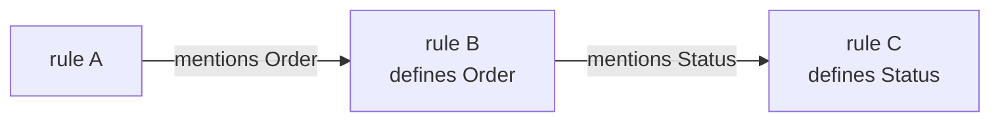

# Spec reference

The spec format, the generated code and the code built on it. The procedure
is [AGENTS.md](AGENTS.md); the agent's loop is the
[`sync` skill](.claude/skills/sync/SKILL.md); the stages of
`pnpm check` are [below](#stages-of-pnpm-check).

In the vibestack repository, "the order example" is
`vibestack/examples/order/spec/index.md` and "the tracker example" is
`vibestack/examples/dashboard/spec/tracker.md`. The root `spec/index.md` links to
`spec/app/index.md`, the hello world in `apps/app` that uses one of each thing
Vibestack offers (`apps/app/README.md`), to be replaced by your application.

## Stages of `pnpm check`

Each line of a report names its stage: `✓` passed, `✗` failed, `-` skipped,
with the reason.

| Stage | Checks | Skipped when |
|---|---|---|
| `model` | each spec parses, and its Quint typechecks | never |
| `always` | `always` rules and laws hold on simulated traces; `leadsTo` rules on fair runs | the spec is not a valid model |
| `sometimes` | each `sometimes` goal is reached, and each event happens in some simulated state | the model is invalid, or simulation stopped at an `always` failure |
| `replay` | the generated TypeScript agrees with Quint on the simulated traces | as `sometimes` |
| `types` | the `vibelang` compiler checks `src/`, the tests and `gen/` ([shell skill](.claude/skills/shell/SKILL.md)) | a stage above failed; without a `tsconfig.json` it passes as skipped only when there is no `src/` or `test/` |
| `proof` | Dafny proves each unit's obligations, or `spec/lock.json` records them as simulated only | model, simulation or replay failed |
| `tests` | the package's [tests](AGENTS.md#tests) pass, each cites a story or rule the spec has and reaches past `gen/`, and its drivers import `gen/` as types only | model, simulation or replay failed |
| `traces` | the application, through its drivers, `driver:` programs and recorded traces, agrees with the spec ([Conformance](#conformance)) | model, simulation or replay failed |
| `review` | every story, rule and contract changed since `spec/lock.json` was accepted ([Review](#review)) | never |

Types and proofs run concurrently. Tests and traces still report their own
results when types or proofs fail; a green result there does not clear the
failed stage.

## Writing a spec

`pnpm exec spec new` fills an empty `spec/index.md` with a starter that passes every
stage but `review`. `pnpm exec spec new <name>` writes `spec/<name>/index.md`;
nested names such as `billing/payments` are allowed. A non-empty spec is
never replaced.

`check` reads every `spec/**/*.md`, including child directories. A spec may
link to another with `[Payments](./payments/)` or
`[Currency](../shared/currency.md)`. Directory links resolve to `index.md`;
references stay inside `spec/`. Links organize the spec; Quint imports bring
in definitions. An empty index or one containing only navigation links is
valid. A `##` story still needs rules.

Each path component uses `[a-z][A-Za-z0-9]*`. The generated module name is
the path relative to `spec/`, without `.md` or a trailing `/index`, with
slashes replaced by `__`: `spec/index.md` becomes `gen/index.ts`,
`spec/billing/index.md` becomes `gen/billing.ts`, and
`spec/billing/payments.md` becomes `gen/billing__payments.ts`. Flat files
remain supported. Two paths cannot name the same module, so use either
`spec/billing.md` or `spec/billing/index.md`. In a monorepo, `spec/billing/`
belongs to the package `apps/billing` or `packages/billing`, which gets these
modules in its own `gen/` under the same names
([One spec tree](#one-spec-tree)).

````markdown
# Order checkout                         <- title, free text

## Story: Check out                      <- a story

> As a shopper, I want to …              <- the story's text

### Only a non-empty draft can be submitted      <- a rule: one checkable sentence

Submitting freezes the order.            <- the rule's prose, optional

```quint
pure def canSubmit(o: Order): bool = o.status == Draft and o.units > 0
pure def submit(o: Order): Order = { ...o, status: Pending }
```
````

| Line | Means |
|---|---|
| `## …` | a story, or any group of rules. Needs at least one rule. Its text runs to its first `###` |
| `### …` | a rule, keyed `<story> / <heading>`, unique in the spec. Needs a `quint` block |
| `` ```quint `` | the rule's formal half; only under a `###` |
| any other fence | prose; `##` and `###` inside it are not headings |
| `####`, bold, anything else | prose of the rule or story above |

A fence is three or more backticks or tildes. It closes only on a line of
the same character, at least as long, with nothing after it, so a fence of
four backticks can hold a ```` ```quint ```` example. A fence is Quint when
the first word of its info string is `quint`.

Quint errors are reported at the source file's path and `line:col`.

### What goes in the Quint blocks

Only types, imports, `pure val`, `pure def` and the `const` of an opaque
function. There is no `var`, no `action`, and no `init` or `step`: the state
machine around your definitions is generated. The role of a definition comes
from its name and signature:

| You write | It is | Generated from it |
|---|---|---|
| `type Order = { … }`, `type Status = A \| B` | the vocabulary | `interface Order`, `type Status = "A" \| "B"` |
| `pure val initial: Order = …` | the initial state; its type is *the state type*. A spec without one is a library | `initial`, `parseState`, and a proof that it satisfies every `always` rule |
| `pure def pay(o: Order, amount: int): Order` | a transition: any `pure def` whose first parameter is the state and that returns the state | `pay(o, amount)`, an `Event` variant `{ type: "pay", amount }`, a case in `step`, `enabled` and `parseEvent`, and proofs that it preserves every rule |
| `pure def canPay(o: Order, amount: int): bool` | the guard of `pay`; takes the state and any subset of its other parameters, matched by name and type | `canPay`, used by `enabled` and `step`. What is proved about `pay` is proved for the cases the guard allows. A guard may call its own transition to look at the result |
| `pure def alwaysPaidWithinDue(o: Order): bool` | a rule that holds in every reachable state | a conjunct of `inv`; simulated and proved |
| `pure def stepNeverGoesBack(before: Order, after: Order): bool` | a rule about every single step | a postcondition on every transition; simulated and proved |
| `pure def stepAuthorized(before: Order, via: str, after: Order): bool` | a step rule that also sees the transition name | a postcondition on every transition |
| `pure def sometimesPaid(o: Order): bool` | a state that must be reachable | a reachability check with a witness trace |
| `pure def refinesL(s: Switch): L::Lamp` | the spec [refines](#refinement) the machine imported as `L` | an obligation on every transition and on `initial`; simulated and proved |
| `pure def leadsToPaid(o: Order, later: Order): bool` | a liveness rule: from every reachable state `o`, every fair run reaches a state `later` that it relates to `o` (`o` itself counts) | a search of simulated traces for a fair run that breaks it ("Liveness", below) |
| `pure def lawTotalIsNotNegative(xs: List[int]): bool` | a law: true for every value of its parameters | a function proved to return `true`, and sampled by the simulator |
| `const hash: (str) => int` | an opaque function: a type and no body. The laws in its rule are assumed of it | see [Opaque functions](#opaque-functions) |
| `type SecretCard = str` | a secret: a type named `Secret…` | nothing new; `check` keeps its values out of every other place ([Secrets](#secrets)) |
| `pure def declassifyLast4(c: SecretCard): str` | the one way out for a secret | a function whose result is public; review names it |
| `pure val idValues = Set(1, 2, 3)` | what the simulator tries for a parameter named `id`. It must be a set whose elements match the parameter type; any supported Quint is allowed in it | nothing: it never reaches TypeScript |
| `pure val weight_pay = 5` | how often the simulator tries `pay`: a whole number from 1 to 100, times as often as an event of weight 1 (the default). For deep interleavings, such as a message lost, repeated and reordered | nothing |
| `pure val fair_pay = "weak"` or `"strong"` | an assumption for `leadsTo` rules: a fair run does not put `pay` off for ever while its guard keeps allowing it (`"weak"`), or while it allows it again and again (`"strong"`) | nothing |
| `pure val within_leadsToPaid = 3` | a bound for a `leadsTo` rule: every run meets it within 3 events, from 1 to 100 | a search of simulated traces for a run that does not ("Liveness", below) |
| any other `pure val` or `pure def` | a constant or helper | the same constant or function |

A transition parameter named `by` identifies its sender. All such parameters
use the same type. It is supplied separately as `enabled(current, event, by)`
and `step(current, event, by)`; it never comes from `parseEvent`. The shell
must validate the authenticated sender before supplying it.

A helper that takes the state first and returns the state would be taken for
a transition. Give it the state as its second parameter, or return something
smaller.

A transition may return a named record `{ state: State, out: List[Effect] }`.
All transitions that return effects use the same record type. In that module,
`step` returns that record; state-only transitions and rejected events return
an empty `out`. A step rule may take a final parameter named `out` to inspect
the effects, after the resulting state. The simulator compares those effects
with the generated TypeScript, and the proof checks each such step rule.

Refused, each with a message saying why: the generated and harness names
(`init`, `step`, `inv`, `enabled`, `parseEvent`, `parseState`, `Event`,
`current`, `event`, `state`, …) and `ProofLib`; JavaScript globals and
keywords (`Number`, `delete`, …); Quint built-ins (`to`, `next`, `all`,
`size`, …); a parameter named like a variant; a variant field called `tag`;
and near-misses of the conventions above such as `alwayspaid` or `CanPay`.
A state machine is also refused the names of its Effect adapter: `Rejected`,
`NotAnEvent`, `NotAState`, `NotASender`, `Machine`, `machine`, `apply`,
`decodeEvent`, `decodeState` and `decodeSender` ([shell skill](.claude/skills/shell/SKILL.md)).

### Using one spec from another

Import paths resolve relative to the spec that contains them. For example,
`import currency.* from "../shared/currency"` uses a sibling area's library,
and `import payments as P from "./payments"` uses `payments/index.md`.
Generated code uses the imported spec's full module path.

- **`import kernel.* from "./kernel"`** takes a library's names as they are.
  A library is a spec with no `initial`: definitions and laws, or a
  *component* such as an account with `canWithdraw` and `withdraw` and no
  state of its own (`vibestack/fixtures/account.md` in the vibestack repository,
  used by `bank.md`).
- **`import lamp as L from "./lamp"`** takes any spec under a name, a state
  machine included. A room can then hold two `L::Lamp`s in its state, start
  them from `L::initial`, move them with `L::toggle`, require
  `L::alwaysFlipsAreCounted` of each, and add rules about the pair that
  neither lamp could state (`vibestack/fixtures/room.md` in the vibestack
  repository).
- **`import net as N from "./net"`** takes a spec that ships with the tools,
  from their `std/` directory, when the importing spec's directory has no
  `net.md` or `net/index.md`. It is simulated and proved with the specs that
  import it, never reviewed.
  [`vibestack/std/net.md`](vibestack/std/net.md) is a network that loses, repeats and reorders:
  the numbers of the messages in flight, with `N::send`, `N::take` (to
  deliver or lose one), `N::repeat`, and laws for an `always` rule that only
  messages sent are in flight. `vibestack/fixtures/ping.md` uses it.

A spec is imported once, one way or the other, and imports cannot form a
circle. Navigation links may point back to a parent. In the generated
TypeScript a name from another module is spelled
`<module>_<name>`, for example `lamp_toggle`.

### One spec tree

The repository has one spec tree, at its root, and one check of it.

| Path | Is |
|---|---|
| `spec/index.md` | the product's requirements: an introduction, and a link to each area |
| `spec/<name>/` | the requirements of the package `apps/<name>` or `packages/<name>`, its *owner*, when there is one with no `spec/` of its own. Nothing else says so: the name does |
| `spec/<name>/` with no such package | an area of the root project; its modules stay in the root's `gen/` |
| a package with its own `spec/` | a project of its own, checked on its own: Studio, each example |

`pnpm check` at the root parses, simulates, proves and reviews the whole tree
once, against the one ledger `spec/lock.json`, and does for each owner what
it does for the root's own `src/` and `test/`:

- **`gen/`.** The modules of the owner's specs, and of every spec they
  import, are also written to `<owner>/gen/` under the names they have in the
  root's: `spec/app/index.md` is `apps/app/gen/app.ts`, with
  `app.effect.vibe` and `app.conformance.ts` (its driver's types); `spec/app/cart.md` is
  `app__cart.ts`; a library `spec/shared/money.md` it imports is
  `shared__money.ts`. A package imports only from its own `gen/`. `pnpm gen`
  and `pnpm install` write it too.
- **Stages.** `types`, `tests` and `traces` run in the owner's directory, on
  its `tsconfig.json`, `test` script, `test/drivers/`, `test/traces/` and
  `driver:` scripts;
  its `//@` files under `src/` are proved and their contracts reviewed. Each
  result names the package: `apps/app: pass`.
- **Citations** in an owner's code are written from the root, as everywhere:
  `// spec/app/index.md, "A rule"`.

An owner has no `check`, `gen` or `accept` script: the root's are its own.

### Opaque functions

`const f: (A, B) => R`, on one line under a rule, declares a function with no
body: a hash, a check the spec does not model, a model's judgement. What the
spec knows of it is the laws in the same rule; they are assumed, not proved,
and review shows them with it. A law about `f` in another rule is proved as
any law is. `vibestack/fixtures/badge.md` in the vibestack repository is the
example.

- **Simulated** as a table chosen for each trace: for each argument the
  simulator tries (the values of its type), a result from the values of `R`,
  or from `fValues` if the spec defines it. A trace starts only with a table
  on which every law of `f` holds for every value tried, so a rule that holds
  only for some tables is broken in simulation. If no table satisfies the
  laws, they may contradict each other, and `always` fails.
- **Proved** with `f` uninterpreted (`function {:axiom} f` in the Dafny) and
  each of its laws as a lemma `<law>_ensures(args)` that a proof file calls.
- **In TypeScript** the program gives it before anything calls it:
  `opaque.f = hashName`, from `gen/<name>.ts`; until then `f` throws. Its
  parameters are `p0`, `p1`, … Nothing proves that what the program gives
  satisfies the laws: prove that in `src/` with a `//@` contract.
- Only simple values (`int`, `bool`, `str`, a plain variant) are its
  arguments, and a spec with an opaque function cannot be imported.

### Secrets

A type whose name starts with `Secret` (`type SecretCard = str`, or a record)
is secret. `model` refuses a spec in which a secret value can reach a place
whose type is not secret: a field, a variant's field such as the text of
something said, an element of a list, set or map, or the result of a
transition, a guard or a helper. A value computed from a secret, or chosen by a
condition on one, is secret too, through calls to helpers as well. Rules only
check, so they may read secrets freely.

The one way out is a definition named `declassify…`: what it returns is
public. Review marks a rule that defines one, whenever it is new or changed,
`and declassifies a secret through <name>`; confirm that what it lets out may
be public. `vibestack/fixtures/card.md` in the vibestack repository is the
example, and `vibestack/examples/assistant` keeps a saved card out of speech
this way. The check reads the spec only: the shell must keep secrets out of
its own logs.

### Refinement

A spec refines a machine it imports under a name by defining
`refines<Alias>`, which maps its state onto that machine's
(`vibestack/fixtures/switch.md` refines `lamp.md` in the vibestack
repository):

```quint
import lamp as L from "./lamp"
pure def refinesL(s: Switch): L::Lamp = { mode: if (s.lit) L::On else L::Off, flips: s.presses }
```

- `refinesL(initial)` must be `L::initial`.
- Every transition must either leave `refinesL` of the state unchanged, or be
  the transition of `L` with the same name, allowed by its guard, on
  `refinesL` of the state before. That transition's parameters are taken from
  this one's by name, as a guard's are. A transition that `L` has no
  namesake for must leave `refinesL` unchanged.
- Simulation checks both on every step, and each is an obligation of the
  proof. Every reachable state then maps onto a reachable state of `L`, so
  every rule of `L` holds of `refinesL` of it, as far as `L`'s own unit
  proved it: the proof line lists what of `L` is simulated only.
- A spec refines at most one machine, whose state holds no set.

### Supported Quint

| In a spec | In TypeScript | Notes |
|---|---|---|
| `int`, `bool`, `str` | `number`, `boolean`, `string` | Integer literals must fit in 2^53 |
| records | interfaces | Nest as deep as you like |
| `type Status = Draft \| Paid` | `"Draft" \| "Paid"` | |
| `type Parcel = Packed({ weight: int }) \| Lost` | `{ tag: "Packed"; weight: number } \| { tag: "Lost" }` | Read with `match p { \| Packed(x) => … \| _ => … }` |
| `List[T]` | `T[]` | `List(…)`, `append`, `concat`, `length`, `nth`, `nthOr`, `removeAt`, `head`, `tail`, `select`, `foldl`, and `every`, `some`, `includes`, `listMap` |
| `Set[T]` of simple values | `T[]` that never holds a value twice | `Set(…)`, `union`, `intersect`, `exclude`, `filter`, `map`, `forall`, `exists`, `contains`, `in`, `subseteq`, `size` |
| `K -> T` | `Record<K, T>` | Keys are integers, strings or plain variants; `Map()`, `put`, `get`, `getOr`, `m.keys().contains(k)` |

Also: `+ - * / %`, comparisons, `and or not implies iff`, `if … else`, record
construction, spread update and field access, calls to your own definitions,
and `val` bindings at the top of a definition. Anything else stops the `model`
stage with the name of the construct.

- **`==` and `includes` compare records, lists, maps and variants by structure.**
  A value holding a set cannot use structural equality; compare sets with
  `subseteq` in both directions.
- **Generated arithmetic refuses an integer result outside the safe range.**
  It throws `RangeError` rather than returning a rounded JavaScript number.
- **`xs.nthOr(i, fallback)` and `m.getOr(k, fallback)` are total lookups.**
  `xs.removeAt(i)` removes one position, or leaves the list unchanged when
  the position is outside it.
- **Guard every partial operation in the definition that uses it.** An index
  outside a list, a missing map key and a zero divisor stop the simulator and
  cannot be proved safe. Test first and give a default, as `problemAt` does
  in the tracker example. For a map the form is exactly
  `if (m.keys().contains(k)) m.get(k) else 0`.
- **`/` and `%` go towards zero**, as in Quint: `-7 / 2` is `-3` and `-7 % 2`
  is `-1`. The generated TypeScript and the proofs agree.
- **There are no loops and no recursion.** To repeat something until done,
  fold over a list that is long enough, as `ancestors` does in the tracker
  example. What needs a real loop is written by hand in `src/` and proved
  there.
- **A set holds simple values only**, and `Set(a, b)` with members that are
  not literals is refused, because the two could be equal: write
  `Set(a).union(Set(b))`. Use a set when duplicates are impossible in the
  real thing and a list when they are not.
- **A map is a lookup table.** It cannot be listed or iterated; keep a list of
  keys beside it, or use a list of records with a key field. An event cannot
  carry one. In the generated state a string key carries a `$` in front, so
  that no key can collide with a property every JavaScript object has.
- **In a `match` arm, use the fields of what the variant carries**
  (`x.weight`), or rebuild the variant (`Packed({ ...x, weight: 2 })`). The
  carried value cannot be passed on whole. `match` must be on a name.
- **`every`, `some`, `includes` and `listMap` are not Quint.** They are
  rewritten into `foldl` before Quint reads the spec, because Quint evaluates
  a definition that takes a lambda wrongly when it is used inside its own
  argument. In TypeScript they are the array methods, except that `every`, a
  set's `forall` and `subseteq` are written `!xs.some(x => !…)`: the proof
  then sees each as a quantifier over the members
  (`!(exists x :: x in xs && !…)`), as it sees `some` and `includes`.
- **The simulator tries small values**: integers −1…6, both booleans, three
  strings, every variant of a plain sum type, and short lists and sets of
  those. Define `<param>Values` to choose, which a record or a variant that
  carries data needs. The sets of an imported spec apply too; the spec's own
  win.

### Writing good rules

- `always` rules alone are satisfied by a system that does nothing. Add a
  `sometimes` rule for each kind of state a story is meant to make possible.
- A guard that never allows its event makes it impossible, and every rule
  then holds of it trivially. `check` fails when no simulated state allows
  one. It also lists guards it never saw refuse their event: such a guard
  often only restates an `always` rule, which is fine when it protects
  `enabled` from outside input, or refuses only beyond the simulator's 20
  events.
- `always` rules must hold *inductively*: from any state that satisfies all of
  them, every transition must lead to a state that satisfies all of them. If
  simulation passes but `proof` fails on a transition, a fact about which
  states are reachable is unstated. In the order example, "Drafts and
  cancelled orders hold no money" is such a fact: delete it and no simulated
  trace fails, but `submit` can no longer be proved to leave a balance.
- Keep simulation bounds out of guards. A guard such as "stop after day 6"
  ends up in the generated code. Bound the simulator with `<param>Values`.
- Compute something once with a `val` when a rule uses it several times;
  repeated folds are what make simulation slow.

### Liveness

A `leadsTo` rule says something happens, not only that nothing bad does:
`leadsToPaid(o, later) = o.status == Pending implies later.status == Paid`.
Its runs are the simulated traces of the `always` stage, each continued for
ever in one of two ways: it stops at a state, or it returns to a state it
had reached before and repeats the loop. Either is *fair* unless it puts off
a fair event: one declared `fair_<event>`, `"weak"` if the event's guard
allows it in every state of the loop (or in the state it stops at),
`"strong"` if in any. A fair run breaks the rule when some state on it is
followed by none the rule relates it to, and `always` fails with that run,
the state marked.

- Without a `fair_` declaration nothing has to happen, so a run may stop
  anywhere: declare fair the events the property waits on, the system's own
  steps and the deliveries the environment promises, and no others.
- An event lost and sent again forever loops; only `"strong"` fairness of
  the delivery rules that out (`vibestack/fixtures/ping.md`).
- "Allows" is for the values the simulator tries (`<param>Values`).
- `within_<rule> = n` also asks that the rule be met within `n` events of
  any state, whatever events they are: a run that takes `n` without meeting
  it breaks the rule, fair or not. Events of the environment count too, so a
  bound holds only where nothing can delay the answer without limit.
- A loop needs a state reached twice. A counter that only grows rules loops
  out, and then only runs that stop are checked: the stage says how many
  loops it found. Nothing proves a `leadsTo` rule.

### Review

`pnpm accept` records a fingerprint of everything a person has
reconciled; `review` lists what differs. Each status, and what it
asks of the agent, is in the [`sync` skill](.claude/skills/sync/SKILL.md).

| What | Recorded in, under | Fingerprint of |
|---|---|---|
| document | `spec/lock.json`, `specs[<path>]["@document"]` | title, introduction and links before the first story, whitespace collapsed |
| story | `spec/lock.json`, `specs[<path>]["## <title>"]` | its text, whitespace collapsed |
| rule | `spec/lock.json`, `specs[<path>][<story> / <heading>]` | 1. its prose, whitespace collapsed<br>2. its Quint<br>3. the Quint of every rule it relies on |
| contract | `spec/lock.json`, `contracts["src/<path>.ts"]`, or `contracts["apps/<name>/src/<path>.ts"]` in an owner | its `//@` lines and the declarations they belong to |



A rule relies on every rule whose Quint defines a name (definition, type or
variant) that its own Quint mentions, transitively and across imports. Above,
editing C's Quint makes A and B `model changed through Status (…C)`; a rule in
another spec is named `spec/<file>: <rule>`. A renamed heading is one rule
removed and one new.

The versioned `spec/lock.json` holds `specs` keyed by source path, `contracts`
keyed by source file, and `unproved` keyed by proof unit. `pnpm exec spec migrate`
consolidates older per-spec ledgers without accepting new reviews or proof
exceptions. A proof exception in the old list form is not carried over: its
obligations are reported as not proved until proved or accepted again. Commit the resulting lock with the specs.

Removed spec paths stay in review until their removal is accepted.

Accept records everything or nothing: only when every other stage passes,
every story has a rule and every rule has Quint.

## Using the generated code

`gen/<name>.ts` exports your types, constants and functions under the names
you gave them, and for a state machine:

```ts
type Event = { type: "addItem"; qty: number } | { type: "submit" } | …
function parseEvent(x: unknown): Event | undefined   // an untrusted value as an event, or not
function parseState(x: unknown): Order | undefined   // an untrusted value as a state that satisfies inv, or not
function enabled(current: Order, event: Event): boolean  // do the rules allow event now?
function step(current: Order, event: Event): Order       // apply event; unchanged if not allowed; { state, out } with output
function inv(current: Order): boolean                    // every always-rule at once
```

Every definition from the spec carries a doc comment naming its rule and spec
line.

- Import with the `.ts` extension, as Node requires:
  `import { type Event, enabled, step } from "../gen/index.ts";`
- **Pass everything that arrives from outside through `parseEvent` or
  `parseState`.** The proofs assume whole numbers and plain data.

  | | Accepts | Extra fields |
  |---|---|---|
  | `parseEvent` | safe integers, sets without duplicates | dropped |
  | `parseState` | the state's exact shape, safe integers, sets without duplicates, and `inv` holds | refused |

  Both return a fresh copy, so nothing the caller keeps can change it
  afterwards.
- Calling a transition directly (`pay(o, 5)`) is only meaningful when its
  guard holds. Application code goes through `apply`, or a `Machine`, of the
  Effect adapter ([shell skill](.claude/skills/shell/SKILL.md)), which use `enabled` and `step`.
- `gen/` is rebuilt by `pnpm gen` and `pnpm check`, and by
  `pnpm install` when every spec is valid.

### Conformance

The `traces` stage runs the real application against each state machine's
spec, in the package whose code it is, with the events the simulator found.
`gen/<name>.ts` is the oracle; the application is reached three ways:

| | Is | Runs |
|---|---|---|
| `test/drivers/<name>.ts` | exports `driver` and, if it chooses, `options`, typed by `gen/<name>.conformance.ts`; imports `gen/` as types only | in a Node of its own that runs VibeLang: the saved counterexamples, a journey to each `sometimes` rule, malformed inputs, then random walks |
| `test/traces/<name>.jsonl` | recorded lines: `{state}` starts, `{event, by?, state?, out?}` steps; at least one state observed | compared line by line |
| `driver:<name>` script | a program, in any language, that answers each `{}` (reset) or `{event, by?}` line with one `{state, out?}` line | on the simulated traces |

`<name>` is the module's name in the root's `gen/`, and the paths are the
package's own: an owner of `spec/app/cart.md` writes
`test/drivers/app__cart.ts` on `gen/app__cart.conformance.ts`, records
`test/traces/app__cart.jsonl` or names its script `driver:app__cart`, all in
`apps/app`. `vibestack/examples/order/test/drivers/index.ts` is a worked
driver; `effectDriver` from `vibestack/testing` builds one from a `Layer`.

A `Driver` has `reset`, `dispatch` (sends an event through the
application's own entry point and returns `"accepted"` or `"refused"`),
`observe` and, for a spec that emits effects, `observeOutput`. With
`receive(key, raw, by?)`, which sends an untrusted value through the
decoding `dispatch` skips, the check also sends each kind of event with an
unknown type, a field of `1.5` or `2^53`, or a field missing, each of which
must be refused and change nothing; and with an extra field and fields that
change when read again, which must do what the clean event does. `options`
are `view` (what of the state `observe` shows), `keys` (the entities walks
interleave), `walks` (at most this many; `0` for a slow driver) and `steps`.
The walks use the fixed normal or nightly profile
([budgets](CONTRIBUTING.md#seeds-and-budgets)).

- **A disagreement is saved.** A journey or walk that disagrees is shrunk
  and written to `test/counterexamples/<name>/<hash>.json`, which every
  later run replays first. Decide which side is wrong, fix it, and commit the
  file: it is a regression test. A saved trace with an event the spec no
  longer has fails with "the spec has outgrown" it: bring it up to date, or
  delete it.
- **A shell that keeps state gets a driver.** When the package's `src/`
  imports `apply` from `gen/<name>.effect.vibe`, it keeps the machine's
  state itself, and `check` writes a `test/drivers/<name>.ts` that fails
  until its `reset`, `dispatch` and `observe` are filled in. It never
  replaces a driver. A shell on the generated `machine()` needs none.

## Large applications

- **One spec per area**, each a few hundred lines: a state machine for each
  thing that has a life cycle, libraries for what they share, and machines
  that import machines where rules span them. `check` runs them in dependency
  order and proves each against the *definitions* of what it imports, not
  their proofs, so the cost of a proof grows with the spec, not with
  everything beneath it. Its proof file may call what their units proved.
- **One tree for every package.** Each application or shared package keeps
  its specs in `spec/<its name>/` and its code in its own directory; the
  root's `check` covers them all ([One spec tree](#one-spec-tree)).
- **Only what changed is checked again.** Each simulation result, a failing
  one too (its seed is fixed), and each passing proof result is kept in
  `.spec-cache/` under a fingerprint of the spec's Quint without its comments,
  everything it imports and the versions of the tools. The specs are simulated at once.
- **The spec covers the rules, not the plumbing.** Chat, HTTP and storage stay
  hand-written around the generated core, as `vibestack/examples/dashboard/src/notify.vibe`
  does for sending messages.

## Checking harder

Simulation is seeded from what it simulates and the fixed profile, so a run
repeats exactly. `pnpm all check -- --nightly` uses the larger nightly profile
and always checks afresh. A
failing `always` rule or an unreached `sometimes` goal prints its seed and the
`pnpm exec quint run` command that replays it.

To check a model exhaustively up to a depth with the Apalache model checker
(needs Java 17+, downloads Apalache on first use):

```sh
pnpm exec quint verify gen/index.run.qnt --main index_run --invariant inv --max-steps 10
```
