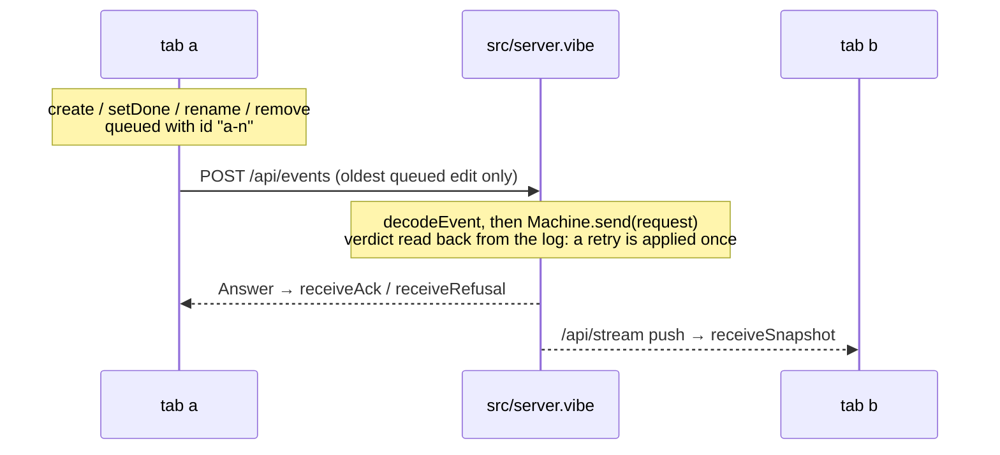

# Shared to-do list, modelled end to end

A Node.js backend and a React page share one to-do list between browser tabs
that may go offline. Both run the machines generated from `spec/`; a fourth
spec puts the server, two tabs and an unreliable network together.

```sh
pnpm install --ignore-workspace   # here, after the install at the repository root
pnpm check      # the whole pipeline (from this directory)
pnpm test       # the tests alone, against the real server on a free port
pnpm start      # build, then open http://localhost:3000 in two windows; the list is kept in ./todos.json
pnpm storybook  # every component of the page in each of its states
pnpm lint       # the page uses the design tokens only
```

Needs Node 26+ and Dafny on the path.

| Path | Kind | Covers |
|---|---|---|
| `spec/index.md` | entry point | Links to the four domain specs |
| `spec/todo.md` | library | A to-do, the four edits, when an edit makes sense, how it is applied |
| `spec/server.md` | machine | One `request` per edit, applied or refused by its edit, answered once, version = number of changes, ids never reused |
| `spec/client.md` | machine | One tab: confirmed copy, queue of unanswered edits, offline, answers and pushes |
| `spec/system.md` | machine | Server + tabs `a` and `b` + a lossy, repeating, reordering network + forged requests |
| `spec/*.proof.dfy` | proofs | What Dafny could not prove alone |
| `src/server.vibe`, `src/main.vibe` | backend shell | `POST /api/events`, `GET /api/snapshot`, `GET /api/stream`, the page's files, and the state saved in `todos.json` |
| `src/protocol.vibe` | shared shell | Wire format |
| `src/web/sync.vibe` | frontend shell | The `Tab` service: one client machine and its requests, shared with `test/app.test.vibe` |
| `test/drivers/client.ts`, `test/drivers/server.ts` | conformance | How `check` reaches a tab and the HTTP server: every journey and random walks, compared with `spec/client.md` and `spec/server.md` |
| `src/web/` | page | React: `useTab.ts` gives `components/TodoPage.tsx` the tab's `Client` and its effects |
| `tokens.json`, `design.md` | design | The page's colors and shapes, as tokens |



## VibeLang and TypeScript

The shell is [VibeLang](https://github.com/smithersai/vibelang) (`.vibe`):
TypeScript syntax for Effect, on `gen/<name>.effect.vibe`, which `pnpm gen`
writes beside each generated module. The server is Effect's `HttpRouter` over
a `Machine` service that applies each event with the generated `apply` and
saves the state before it answers; a tab keeps its `Client` in the `Machine`
that `gen/client.effect.vibe` generates, and changes it only through `send`
and `receive`.

## Where the list is kept

`server(web, listener, file)` starts from the state saved in `file`, or from
an empty list if there is none, and refuses to start, with `NotAStateFile`
naming it, on a file it cannot read, that is not JSON or that is not a state
that keeps the server's rules. Each request it takes is saved before it is
answered: written to `file.tmp`, flushed to disk, renamed over `file`, and
the rename flushed with the directory, one request at a time. Where a
directory cannot be opened, as on Windows, that last flush is left to the
system, and a power cut just after an answer may undo its rename. `pnpm start` keeps it in
`todos.json` in the directory it is run from; delete that file to start
over.

| Stays TypeScript | Why |
|---|---|
| `gen/*.ts` | generated, and what the proofs are about |
| `src/web/**/*.tsx`, `useTab.ts` | React and the DOM, which a `.vibe` file cannot touch; `useTab.ts` runs the tab's effects through a `ManagedRuntime` |
| `vite.config.ts`, `vitest.config.ts`, `eslint.config.js`, `.storybook/` | configuration the tools load themselves |

## The page

The generated client `Machine`, which `browser()` of `sync.vibe` provides to
the `Tab`, holds the client's state. `useTab.ts` hands every
state it publishes to `TodoPage`, whose components take that `Client` and
callbacks as props, offer a control exactly when the generated guard allows
its event (`canCreate`, `canSetDone`, `canRename`, `canRemove`, `canGoOffline`,
`canGoOnline`), and keep only text being typed in `useState`.

| Command | Does |
|---|---|
| `pnpm build` | the server (`vibelang`, to `dist/src`), the theme, and the page (Vite, to `dist/web`, which the server serves) |
| `pnpm tokens` | `generated/theme.css` and the table in `design.md`, from `tokens.json`; `node ../../spec.ts tokens check` fails on contrast below WCAG AA |
| `pnpm stories` | `generated/stories/`: stories of each component in `src/web/components/`, from its props and its `<Name>.meta.tsx`, and a test that mounts each |
| `pnpm storybook` | Storybook over those stories, regenerated as components change |

`pnpm test` writes the theme and the stories, builds the page, and runs the
shell's journeys and the mount of every story.

## Proved, simulated, tested, trusted

- **Proved**: every transition of server, client and system keeps every
  `always` and `step` rule, and every law holds. `pnpm check` gives the count.
- **Simulated**: the `sometimes` rules, among them that both tabs can finish
  their edits and agree with the server despite loss, duplication and reordering.
- **Tested**: the HTTP shell and two tabs against the real server (`test/`),
  including a restart on the same state file and a start refused on a file
  that holds no state; the real server against `spec/server.md`, through its
  driver, comparing the state it saved in its file with the spec's and each
  answer's verdict with its log; a tab against `spec/client.md` through its
  driver; that every story mounts. No test drives the page in a browser.
- **Trusted**: `src/`, React, Effect, the VibeLang compiler, the generator,
  Dafny and Quint. Convergence is a `sometimes` rule: the model shows it can
  happen, not that it always does.

## Proof structure

List and record equality use `==`; removing a network position uses
`removeAt`. Their former hand-written walks and induction proofs are gone.

The system uses the server's request law and laws about the client's generic
queue and answer helpers. Those helpers preserve every field of an arbitrary
`Op`, including fields an operation does not use. The named edit transitions
construct an operation with normalized fields, so their imported proofs cannot
replace the generic queue law without changing the logged request and retry
identity.

Agreement remains a reachability property. This network can lose messages
forever, so convergence on every run would require an additional delivery
fairness assumption.

## Limits of the spec language met here

- **A machine cannot be imported with `.*`**; the system spec uses `S::` and `C::`.
- **Folds with record accumulators need a named type.**
- **A helper that takes the state first and returns it is a transition**, so
  `commit`, `queue` and `withClient` take it second.
